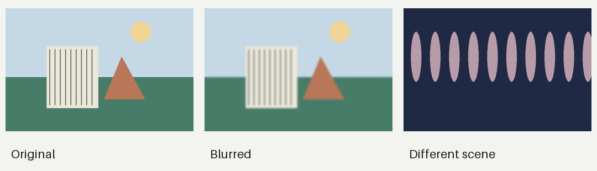

# Photo Select Lab

A small tool for sorting through a folder of similar photos. It groups likely
duplicates and makes a contact sheet so you can compare them without opening
everything separately.



## Give it a try

Python 3.11+, NumPy, and Pillow.

```bash
python -m pip install -r requirements.txt
python review.py examples/demo --output outputs/demo
```

Open `outputs/demo/index.html`. You'll get thumbnails, groups, and a CSV with
the image stats. The demo images are just generated shapes and colors.

For another folder:

```bash
python review.py /path/to/photos --output outputs/my-photos
```

Use an empty output folder outside the photo folder. The originals stay as they
are. Reports contain thumbnails and filenames, so keep them local if the photos
are private.

## What's going on

Exact copies are easy: compare file hashes. For similar images, it uses a small
image hash plus color and aspect ratio. Every image in a group has to match the
others, which helps avoid one huge group of vaguely similar pictures.

Within each group, sharper images come first. That's a starting point, not a
verdict. A perfectly sharp photo can still be the one you don't want.

The [notebook](notebooks/review_baseline.ipynb) walks through blur, color, and a
few grouping settings. You'll need Jupyter if you want to run it yourself.

## Speed check

Run `python benchmark.py` to time scanning and grouping on throwaway generated
images. It prints your machine details and median times for a few batch sizes.
These shapes are useful for timing, but a real photo folder may behave differently.

## Local video studio

The first [studio viewer](studio/) is ready for reviewing an original clip beside
an optional result. Choose or drop video files, set a start and end time, scrub
and nudge through the clip, and play both previews together. The page shows clip
duration and resolution. It keeps selected files in your browser session; the
local server only serves the studio files and bundled demo.

From the repo folder:

```bash
python -m http.server 8767 --bind 127.0.0.1 --directory studio
```

Open `http://127.0.0.1:8767/` and click **Load procedural demo**, or
choose your own videos. The two small MP4 demos are moving test shapes and a
grayscale variation. You can regenerate them with `python studio/make_demo.py`
if FFmpeg is installed. Pause the original, choose Include or Exclude, and
click to draft a circular mask. Use Edit to move a circle or delete one mark.
The white-on-transparent PNG exports at the source resolution without video
pixels. Save draft JSON to keep the selected range and mask circles, then load
the same original clip and reopen the JSON
later. The file contains settings only; matching resolution and duration helps
catch mixups but cannot identify a clip. The mask belongs to one frame; it
does not track a subject through the clip. No model runs in this version; saved
jobs and optional render engines are next steps.

## Things I'd like to add

- Compare this with image embeddings on real duplicate pairs.
- Learn from which shots someone actually chooses to keep.
- Extend the studio with real render progress
  when an optional engine is connected.

The studio grew out of an AI-assisted side project around existing models.
Trying this viewer doesn't need a GPU or a model download.

For now, this works best on one shoot at a time. Big crops, rotation, and major
lighting changes can confuse the grouping. No RAW support yet.

Code: MIT. No personal photos, generated personal edits, or model weights are
included.
