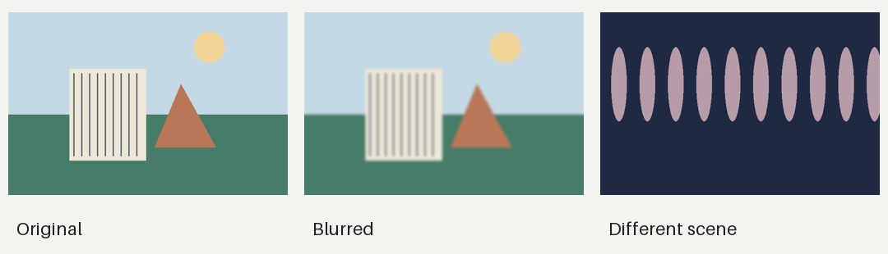

# Photo Select Lab

A small tool for sorting through a folder of similar photos. It groups likely
duplicates and makes a contact sheet so you can compare them without opening
everything separately.



## Give it a try

Python 3.11+, NumPy, and Pillow.

```bash
python -m pip install -r requirements.txt
python review.py examples/demo --output outputs/demo
```

Open `outputs/demo/index.html`. You'll get thumbnails, groups, and a CSV with
the image stats. Choose Keep, Reject, or Unsure on each card and save a versioned
JSON label table when you're done. Load that file to continue later; labels only
apply when every filename and file digest matches the report. Nothing is sent
to a server. The demo images are just generated shapes and colors.

To collect initial labels without showing the sharpness order, run
`python review.py examples/demo --output outputs/demo-shuffled --shuffle-seed 42`.
The cards shuffle within each group, and the page hides displayed rank and
image metrics while you choose. The saved labels still carry original ranks
for validation. Filenames remain visible and may influence a decision; use
separate shoots for training and held-out review.

For another folder:

```bash
python review.py /path/to/photos --output outputs/my-photos
```

Use an empty output folder outside the photo folder. The originals stay as they
are. Reports contain thumbnails and filenames, so keep them local if the photos
are private.

## What's going on

Exact copies are easy: compare file hashes. For similar images, it uses a small
image hash plus color and aspect ratio. Every image in a group has to match the
others, which helps avoid one huge group of vaguely similar pictures.

Within each group, sharper images come first. That's a starting point, not a
verdict. A perfectly sharp photo can still be the one you don't want.

The [notebook](notebooks/review_baseline.ipynb) walks through blur, color, and a
few grouping settings. You'll need Jupyter if you want to run it yourself.

To see how this matcher handles crops and exposure changes on one photo:

```bash
python diagnose.py examples/demo/scene.png
```

The command makes two center crops and two brightness variants in memory. It
reports the hash distance, color difference, and whether each variant still
matches the original under the current grouping thresholds. Try a local photo
to investigate a missed duplicate; nothing is saved or uploaded. These controlled
changes are diagnostics, not a real-photo accuracy score.

To turn reviewed Keep-versus-Reject choices into preference pairs, give each
report a shoot ID and its saved labels:

```bash
python prepare_pairs.py --shoot demo outputs/demo /path/to/photo-review-labels.json --output outputs/demo-pairs.json
```

The tool checks every label against the report's filename, digest, group and
rank. It pairs a kept image with a rejected image only inside the same group,
skips identical files, and assigns whole shoots to train or validation with a
repeatable seed. It stops if the same image lands in both splits. Add more
`--shoot ID REPORT LABELS` entries for more shoots.
Unlabeled and Unsure images make no pairs. The JSON contains filenames and
choices, so keep it local. The pairs infer preference from those choices; they
are not direct pairwise votes. This step does not fit a model or measure accuracy.

To join those pairs to the fixed measurements in each report:

```bash
python preference_features.py outputs/demo-pairs.json --report demo outputs/demo --output outputs/demo-features.json
```

Repeat `--report ID FOLDER` for every shoot in the pairs file. The script checks
filenames, digests, groups, and shoot splits against the reports. It scales
aspect ratio, sharpness, brightness, dark fraction, and bright fraction using
unique images from training pairs only; validation pairs use those same scales.
The output keeps local filenames and review choices, so leave it in an ignored
folder. It prepares inputs for a ranker; this step does not train or evaluate one.

Fit a small linear pairwise baseline on those prepared pairs:

```bash
python train_ranker.py outputs/demo-features.json --output outputs/demo-ranker.json
```

The model uses the preferred-minus-other feature differences and gives each
training shoot equal total weight. It saves feature scales, coefficients,
training settings, the input file digest, and the count of validation pairs
where the preferred image scores higher. Its JSON contains model weights and
belongs only in an ignored local folder. Demo labels check the training code;
they do not establish real-photo ranking quality. Keep actual review data and
future held-out evaluation local too.

For direct image choices, make a second local review page from an existing
report:

```bash
python pair_review.py outputs/demo
```

Open `outputs/demo/pair-review.html`. It puts the group's current top-ranked
image beside up to four distinct alternatives, with Left, Right, Tie and
Unsure choices. Save the versioned votes JSON before closing; loading it back
checks every pair ID, group and image digest. This page collects direct
choices separately from the Keep/Reject labels above. It does not retrain the
ranker automatically. Thumbnails and vote files can reveal private photos or
filenames, so keep the report and votes local.

When you have saved direct votes, turn them into ranker input with the same
shoot IDs and whole-shoot split used above:

```bash
python prepare_direct_pairs.py --shoot demo outputs/demo /path/to/photo-pair-votes.json --output outputs/demo-direct-pairs.json
python preference_features.py outputs/demo-direct-pairs.json --report demo outputs/demo --output outputs/demo-direct-features.json
```

Only Left and Right votes become preference pairs. Ties, Unsure and blank
choices stay counted but are not forced into a winner. The converter verifies
every pair against the report and rejects identical images crossing training
and validation shoots. If you used `--max-opponents` when making the page,
pass the same value when preparing votes. Direct votes remain distinct from
Keep/Reject-derived pairs through training and local evaluation.

To inspect a saved model's order on an existing report:

```bash
python rank_report.py outputs/demo outputs/demo-ranker.json
```

Open `outputs/demo/ranker-review.html`. Each card shows its learned score and
model position beside its original sharpness-based rank. The page stays with
the report's local thumbnails and does not change the source photos. You can
save and reload Keep/Reject/Unsure labels in the same JSON format as the
original report, including the original rank. Keep that file local. Reviewing
in model order can influence choices, so judge ranking on independent held-out
reviews. A model trained on demo choices is only a workflow check; its score
is not a photo quality rating or evidence that ranking improved.

For a shuffled review that hides both model scores and earlier ranks while you
choose, run `python rank_report.py outputs/demo outputs/demo-ranker.json --shuffle`.
Open `outputs/demo/shuffled-review.html`. The shuffle is repeatable with `--seed`.
Its label export still records original ranks so the existing preparation step
can validate it. Filenames remain visible and may still influence choices;
keep held-out reviews independent of training shoots.

To inspect its held-out choices against the existing sharpness order:

```bash
python evaluate_ranker.py outputs/demo-features.json outputs/demo-ranker.json --output outputs/demo-ranking-review.json
```

This checks the feature-file digest saved with the model, then reports counts
by validation shoot and lists pairs where the ranker and sharpness disagree.
It never evaluates training pairs. With no held-out pairs, it says so; the
procedural demo cannot support a real-photo quality claim. The review output
contains local filenames and stays ignored.

## Speed check

Run `python benchmark.py` to time scanning and grouping on throwaway generated
images. It prints your machine details and median times for a few batch sizes.
These shapes are useful for timing, but a real photo folder may behave differently.

## Local video studio

The first [studio viewer](studio/) is ready for reviewing an original clip beside
an optional result. Choose or drop video files, set a start and end time, scrub
and nudge through the clip, and play both previews together. The page shows clip
duration and resolution. It keeps selected files in your browser session; the
local server only serves the studio files and bundled demo.

From the repo folder:

```bash
python -m http.server 8767 --bind 127.0.0.1 --directory studio
```

Open `http://127.0.0.1:8767/` and click **Load procedural demo**, or
choose your own videos. The two small MP4 demos are moving test shapes and a
grayscale variation. You can regenerate them with `python studio/make_demo.py`
if FFmpeg is installed. Pause the original, choose Include or Exclude, and
click to draft a circular mask. Use Edit to move a circle or delete one mark.
With both clips loaded, the wipe view shows the result to the left of its line
and the original to the right. Drag the slider to inspect a change at the
current time; mismatched clip sizes are fitted into the same view and called out.
**Build contact sheet** samples six moments from the selected range without
moving the viewer. It puts the result beside the original when both cover the
range; click a row or its time button to jump both viewers to that moment.
You can inspect the sheet and save a PNG locally. The PNG contains sampled
video frames, so keep it private if you used private clips.
The white-on-transparent PNG exports at the source resolution without video
pixels. Save draft JSON to keep the selected range, mask circles, current
position, wipe setting, and RGB threshold. If you saved a result comparison,
load both clips again before opening the draft. Older range-and-mask drafts
still open. The file contains settings only; matching resolution and duration
helps catch mixups but cannot identify
either clip. The mask belongs to one frame; it
does not track a subject through the clip. With a matching result clip, pause at
the marked frame and use **Check changed pixels** to see how many pixels differ
inside and outside the mask. A local map shows changed pixels in green inside
the mask and coral outside it, over a dimmed original frame. The RGB threshold
ignores small color changes; large frames are sampled down to fit within 960
pixels. This local count cannot
judge edit quality. **Scan nearby frames** checks up to five moments within a
quarter second of the mark. It shows the outside-mask change rate at each frame,
how much that rate varies, and the largest shift in which pixels count as changed.
Click a sample to inspect it in the wipe view. The mask stays fixed, so subject
motion can affect these numbers too; they flag frames to review, not proven
flicker. No model runs in this version; saved jobs and optional render engines
are next steps.

## Things I'd like to add

- Compare this with image embeddings on real duplicate pairs.
- Learn from which shots someone actually chooses to keep.
- Extend the studio with real render progress
  when an optional engine is connected.

The studio grew out of an AI-assisted side project around existing models.
Trying this viewer doesn't need a GPU or a model download.

For now, this works best on one shoot at a time. Big crops, rotation, and major
lighting changes can confuse the grouping. No RAW support yet.

Code: MIT. No personal photos, generated personal edits, or model weights are
included.
